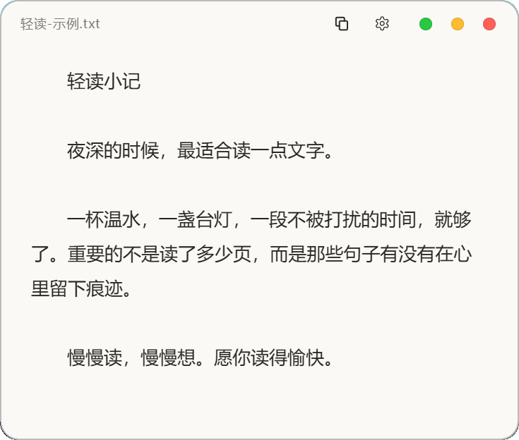

# 轻读（Qingdu）— 轻量 TXT 阅读器

一个干净、无干扰的 Windows 桌面 TXT 阅读器，Python + pywebview 构建，界面为单文件 HTML。

## 界面预览



## 功能特性

- **纯净阅读**：无边框圆角窗口、可拖动标题栏、纸色/深色两套主题
- **排版调节**：字号缩放、中英文字体（默认自动）、首行缩进开关
- **编码自动识别**：UTF-8 / UTF-16 / GB18030（GBK），常见 txt 不乱码
- **偏好记忆**：字号、主题、窗口宽度等保存在 `~/.mimo_txt_reader.json`，下次打开保持
- **文件关联**：一键把 `.txt` 关联到轻读，双击 txt 直接打开
- **原生窗口**：支持最小化/最大化/关闭，毛玻璃背景（Windows 11）

## 环境要求

- Windows 10 / 11 x64
- [WebView2 运行时](https://developer.microsoft.com/microsoft-edge/webview2/)（Win11 自带）
- Python 3.10+ 与依赖：`pip install pywebview`

## 快速开始

```powershell
python main.py                  # 打开阅读器
python main.py 某本书.txt       # 直接打开指定文件
```

## 关联 .txt 文件

```powershell
python register_assoc.py
```

执行后双击任意 `.txt` 即可用轻读打开（可随时在系统"默认应用"里改回）。

## 打包为 exe

```powershell
powershell -File build.ps1
```

产物在 `dist\轻读.exe`，单文件免安装，可分发。

## 项目结构

```
main.py            主程序（窗口、API、编码、配置）
ui/index.html      界面（阅读视图 + 设置面板）
register_assoc.py  .txt 文件关联
build_app.py       PyInstaller 打包逻辑
build.ps1          一键打包脚本
icon.ico           应用图标
assets/            示例文本与图片资源
```

## 配置文件

`~/.mimo_txt_reader.json`，可手动编辑：

| 字段 | 说明 | 默认 |
|------|------|------|
| `fontSize` | 正文字号 | 18 |
| `prefWidth` | 窗口宽度 | 520 |
| `zhFont` / `enFont` | 中/英文字体 | 自动 |
| `bgMode` | 主题：`paper` / `dark` | paper |
| `indentFirstLine` | 首行缩进 | true |
